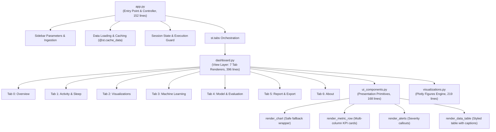

# Architecture: Streamlit App & Dashboard Integration

## 1. Architectural Overview

Across **Phase 2** and **Phase 3**, the frontend layer of the Smartwatch Heart-Rate Analyzer was transformed into a decoupled, highly maintainable three-tier architecture:

---

## 2. Layer Responsibilities

| Component | Lines | Responsibility |
|---|---|---|
| [`app.py`](../../app.py) | 152 | **Application Controller**: Initializes `st.set_page_config`, handles data ingestion (file uploaders, sample data, companion detection), manages `@st.cache_data` analysis execution, controls sidebar configuration, guards session state (`res`, `ctx_frames`, `uid`, `src`), and delegates rendering to `render_dashboard`. |
| [`dashboard.py`](../../dashboard.py) | 396 | **Dashboard View Engine**: Encapsulates layout, subheaders, interactive widgets, and structure for all 7 application tabs. Coordinates chart generation from `visualizations.py` and widget rendering from `ui_components.py`. |
| [`ui_components.py`](../../ui_components.py) | 168 | **Presentation Design System**: Reusable Streamlit presentation primitives (`render_chart`, `render_metric_row`, `render_alerts`, `render_data_table`) with zero state mutation. |
| [`visualizations.py`](../../visualizations.py) | 219 | **Data-to-Figure Transformation**: Pure Python module constructing Plotly figures from Pandas DataFrames with centralized `ACT_COLORS` theming and input safety guards. |

---

## 3. Tab-by-Tab Implementation in `dashboard.py`

### Tab 0: "Overview" (`render_tab_overview`)
* **Data Sources**: `result.quality`, `result.stats`, `result.interpretation`
* **Components**:
  * Participant caption and time window.
  * `render_metric_row` for Data Quality (Quality score, Coverage %, Duration days, Sampling grid).
  * `render_alerts` for quality warnings (`icon="⚠️"`).
  * `render_metric_row` for Key Numbers (Resting HR, Average HR, Peak HR, Overnight low).
  * Automated plain-language interpretation summaries, alert callouts, and disclaimer.

### Tab 1: "Activity & Sleep" (`render_tab_activity_sleep`)
* **Data Sources**: `result.context["hr_by_activity"]`, `result.minutes`, `result.stats`
* **Components**:
  * Source indicator caption (`observed` vs `estimated`).
  * `activity_bar(by)` and `activity_pie(by)` via `render_chart`.
  * `activity_scatter(minutes)` full width via `render_chart`.
  * "High heart rate while still" table (`elevated_rest_episodes`) via `render_data_table` (or success message if none found).

### Tab 2: "Visualizations" (`render_tab_visualizations`)
* **Data Sources**: `result.clean`, `anom`, `result.circadian`, `result.daily`, `result.peaks`
* **Components**:
  * Moving-average checkbox toggle (`show_ma`).
  * `hr_timeline(clean, anom, show_ma=show_ma)` via `render_chart`.
  * `hr_histogram(clean)` and `circadian_trend(result.circadian)` via `render_chart`.
  * `daily_trend(result.daily)` full width via `render_chart`.
  * "Exercise episodes and recovery" peak-detection table via `render_data_table`.

### Tab 3: "Machine Learning" (`render_tab_machine_learning`)
* **Data Sources**: `result.anomalies`, `anom`, `result.clusters`
* **Components**:
  * Algorithm description text (Isolation Forest vs. Local Outlier Factor, context-awareness status).
  * `anomaly_score_histogram(anom)` via `render_chart`.
  * Top-50 unusual windows table via `render_data_table` (sorted by anomaly score, rounded to 2 decimals).
  * KMeans behavior cluster profile table via `render_data_table`.
  * `cluster_scatter(ct)` via `render_chart`.

### Tab 4: "Model & Evaluation" (`render_tab_model_evaluation`)
* **Data Sources**: `result.activity_model`, `result.clean`, `result.quality`
* **Components**:
  * Supervised model evaluation metrics (Accuracy, Balanced Accuracy, Macro F1, ROC-AUC) via `render_metric_row`.
  * Baseline comparison table and per-class metrics table via `render_data_table`.
  * `confusion_matrix_heatmap` via `render_chart`.
  * Interactive anomaly-detector benchmark button (`st.button("Run benchmark on this recording")`):
    * Computes 3-seed injected-anomaly evaluation using `evaluate_anomaly_detection`.
    * Renders evaluation metrics (Recall, Precision, F1, ROC-AUC, PR-AUC) via `render_metric_row`.

### Tab 5: "Report & Export" (`render_tab_report_export`)
* **Data Sources**: `result`
* **Components**:
  * `build_pdf(result, ...)` with `st.download_button` (`application/pdf`, `type="primary"`).
  * `build_csv_bundle(result)` with individual download buttons preserving exact filenames and keys (`key=name`).

### Tab 6: "About" (`render_tab_about`)
* **Components**:
  * Markdown table mapping project objectives to application tabs.
  * Technical and clinical limitations overview.
  * Medical disclaimer caption.

---

## 4. Preservation of Non-Visualization Systems

* **Sidebar & Configuration**: Retains all data loading modes (Sample 7-day, HR-only, Synthetic, CSV uploader), model configuration sliders, and the "Run analysis" action button.
* **State Management**: `st.session_state["res"]`, `st.session_state["ctx_frames"]`, `st.session_state["uid"]`, and `st.session_state["src"]` lifecycles remain completely intact.
* **Backend Isolation**: `hr_backend/` remains strictly untouched, maintaining clear team boundaries between Person A and Person B.
